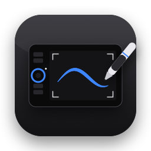

# Tablet

[English](README.md) · **Čeština**

Nativní aplikace pro macOS, která vrací do života grafický tablet **Wacom Intuos Pro M (PTH-651)**
na nových verzích macOS, pro které už Wacom ovladač nevydává. V základní podobě funguje i s dalšími tablety,
které podporuje OpenTabletDriver.

## Instalace

Stáhněte `Tablet-x.y.dmg` z [Releases](https://github.com/zdkdsgn/tablet/releases), přetáhněte Tablet do Aplikací
a při prvním spuštění povolte v **Nastavení systému → Soukromí a zabezpečení** „Přesto otevřít“
(aplikace není notarizovaná u Applu). Pak povolte **Zpřístupnění** a **Sledování vstupu**.



## Jak to funguje

- Pero a ExpressKeys obsluhuje démon **OpenTabletDriveru**, který je **přibalený přímo v aplikaci**
  (`Tablet.app/Contents/Helpers/OpenTabletDriver.Daemon`). Samostatný OpenTabletDriver instalovat nemusíte.
  Pokud ho máte, Tablet jeho démona při startu zastaví a spustí svůj, aby s tabletem mluvil jen jeden ovladač.
- **Tablet** nahrazuje okno OpenTabletDriveru: zapisuje do `settings.json`
  (`~/Library/Application Support/OpenTabletDriver`) a démonovi ho rovnou předá přes jeho JSON-RPC socket
  (`$TMPDIR/CoreFxPipe_OpenTabletDriver.Daemon`, metoda `SetSettings`).
- Touch Ring, jeho tlačítko a světýlka obsluhuje Tablet přímo přes IOKit HID. Zařízení si nezabírá,
  takže OpenTabletDriver běží dál.

## Co umí

- **Tablet:** kresba tabletu s popisky. ExpressKeys mají zkratky nahrávané stiskem kláves (fyzické klávesy,
  takže fungují s jakoukoli klávesnicí, třeba s českou QWERTZ), kliknutí myší a vlastní názvy.
  Volitelně se při stisku ukáže oznámení na obrazovce. Místo zkratky můžou mít **funkci aplikace**:
  - **Přesný režim:** dokud tlačítko držíte, pero se pohybuje jemněji.
  - **Další monitor:** přepne mapování tabletu na další obrazovku.
  - **Kruhové menu:** podržíte tlačítko, perem vyberete jednu z 8 akcí a tlačítko pustíte.
- **Touch Ring:** plynulý zoom ke kurzoru (jemné posouvání s ⌥ nebo ⌘ podle aplikace). Tlačítko uprostřed přepíná
  vybrané režimy (nejvýš 4, podle počtu světýlek): Zoom, Velikost štětce, Historie, Posouvání
  a Otáčení plátna (Photoshop).
- **Světla:** světýlka kolečka a rohová světýlka plochy (jas, zapnutí a vypnutí, dýchání) a animace.
  Easter egg odemkne podržení tlačítka uprostřed kolečka.
- **Pero:** **křivka tlaku** (graf s tažitelným bodem, předvolby Měkký, Lineární a Tvrdý, „plný tlak při“),
  **vyhlazení tahu**, nastavení přesného režimu, zkušební plocha s ukazatelem tlaku, práh hrotu, vypnutí tlaku
  nebo náklonu a tlačítka pera i guma. Křivku, vyhlazení a přesný režim aplikuje Tablet na události pera
  od ovladače (event tap), takže fungují v každé aplikaci.
- **Okraje obrazovky:** kurzor pera zůstane uvnitř obrazovky a na okraji „tlačí“ ven, takže se automaticky
  skrytý Dock vysune i perem.
- **Plocha a monitor:** výběr monitoru, plocha tabletu posouvaná tažením, zachování poměru stran a režim pro leváky.
- **Předvolby:** uložená nastavení a automatické přepínání podle aplikace, která je vpředu. Spouštění po přihlášení.
- **Dotyk:** gesta jako na trackpadu. Je hotové, ale na testovaném kusu tabletu dotyková vrstva neposílá data,
  takže to není ověřené.
- **Express View:** lehké položení prstu na ExpressKeys ukáže u okraje obrazovky, co všechna tlačítka dělají
  (dotyk tlačítek hlásí bajt 5 zprávy podložky).
- **Dotyková tlačítka:** přejetí prstem po čtveřici ExpressKeys funguje jako posuvník (velikost štětce,
  historie, zoom, posouvání, vlastní zkratky). Světla můžou v klidu zhasnout a rozsvítit se až při dotyku.
- **Ikona v liště:** stav připojení, režim kolečka, předvolby a rychlé přepínače.
- **Kontrola ovladače:** jednou denně se podívá, jestli nevyšla novější verze OpenTabletDriveru.
- **Jazyk:** čeština a angličtina podle jazyka macOS. Překlady jsou v `Resources/en.lproj`
  a generuje je skript `Resources/translations-en.py`.

### Podporované tablety

| Úroveň | Tablety | Funkce |
|---|---|---|
| Rozšířená | Intuos Pro 2013 (PTH-451/651/851), Intuos5 (PTK-450/650/850, PTH-450/650/850) | všechno výše |
| Základní | ostatní tablety podporované OpenTabletDriverem | pero, křivka tlaku, vyhlazení, plocha, monitor, ExpressKeys a kolečko přes OpenTabletDriver, předvolby |

Ověřené je to jen s PTH-651. Hlášení o dalších tabletech jsou vítaná.

## Sestavení

Potřebujete macOS 14 nebo novější a Xcode (nebo Command Line Tools se Swiftem 5.10 a novějším).

```bash
./make-app.sh            # stáhne a ověří OpenTabletDriver (jen poprvé) a sestaví build/Tablet.app
./make-app.sh --install  # a zkopíruje ji do /Applications
./make-dmg.sh            # instalační build/Tablet-<verze>.dmg
```

Aplikace je podepsaná ad hoc, s požadavkem na podpis vázaným jen na identifikátor balíčku. Díky tomu si macOS
pamatuje udělená oprávnění i po novém sestavení. Identifikátor si můžete změnit v `make-app.sh`.

### Oprávnění (Nastavení systému → Soukromí a zabezpečení)

- **Zpřístupnění:** posílání událostí (zoom, klávesy, kurzor).
- **Sledování vstupu:** čtení kolečka, tlačítek a dotyku z tabletu.

## Poznámky k hardwaru (PTH-651, USB 056A:0315)

- Zprávy podložky (report ID 3, rozhraní pera 0xFF0D): bajt 2 = Touch Ring (bit 7 = prst na kolečku,
  hodnoty 0–71), bajt 3 bit 0 = tlačítko uprostřed, bajt 4 = ExpressKeys.
- Světýlka: feature report `0x20`, bajt 1 = `jas_rohů << 4 | jas_kolečka << 2 | světýlko`. Jas 0 je slabě,
  1 středně, 2 jasně a 3 vypnuto. Stejně to dělá ovladač `wacom` v Linuxu.
- Dotyk: rozhraní 0xFF00, 64bajtové zprávy (report ID 2).

## Licence

Kód aplikace je pod licencí MIT. [OpenTabletDriver](https://github.com/OpenTabletDriver/OpenTabletDriver) je samostatný projekt
pod licencí LGPL-3.0. Repozitář ho neobsahuje: `make-app.sh` stáhne jeho oficiální vydání (verze a SHA-256
jsou uvedené ve skriptu) a přibalí do aplikace nezměněný démon spolu s jeho licencí
(`Contents/Resources/OpenTabletDriver-LICENSE.txt`). Démona jde kdykoli nahradit jinou verzí.
