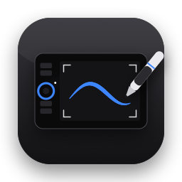

# Tablet

**English** · [Čeština](README.cs.md)

A native macOS app that brings the **Wacom Intuos Pro M (PTH-651)** graphics tablet back to life on current
versions of macOS, which Wacom no longer supports with a driver. At a basic level it also works with other
tablets that OpenTabletDriver supports.

## Installation

Download `Tablet-x.y.dmg` from [Releases](https://github.com/zdkdsgn/tablet/releases) and drag Tablet into
Applications. On first launch, open **System Settings → Privacy & Security** and click **Open Anyway**
(the app is not notarised by Apple). Then allow Tablet under **Accessibility** and **Input Monitoring**.



## How it works

- The pen and ExpressKeys are handled by the **OpenTabletDriver** daemon, which is **bundled inside the app**
  (`Tablet.app/Contents/Helpers/OpenTabletDriver.Daemon`). You don't need to install OpenTabletDriver separately.
  If you have it, Tablet stops its daemon on launch and starts its own, so only one driver talks to the tablet.
- **Tablet** replaces OpenTabletDriver's settings window: it writes `settings.json`
  (`~/Library/Application Support/OpenTabletDriver`) and hands it straight to the daemon over its JSON-RPC socket
  (`$TMPDIR/CoreFxPipe_OpenTabletDriver.Daemon`, method `SetSettings`).
- The Touch Ring, its button and the lights are handled by Tablet directly through IOKit HID. It doesn't seize the
  device, so OpenTabletDriver keeps working.

## Features

- **Tablet:** a drawing of the tablet with labels. ExpressKeys get shortcuts recorded by pressing them (physical
  keys, so they work with any keyboard layout, e.g. Czech QWERTZ), mouse clicks and custom names.
  Optionally an on-screen notice appears when a key is pressed. Instead of a shortcut a key can have an
  **app function**:
  - **Precision mode:** while you hold the key, the pen moves more finely.
  - **Next display:** switches which display the tablet maps to.
  - **Radial menu:** hold the key, pick one of 8 actions with the pen and release the key.
- **Touch Ring:** smooth zoom towards the cursor (fine scrolling with ⌥ or ⌘ depending on the app). The centre
  button cycles the chosen modes (up to 4, one per light): Zoom, Brush size, History, Scroll and
  Rotate canvas (Photoshop). Accidental ring touches while pressing the centre button are ignored.
- **Lights:** ring lights and the four area corner lights (brightness, on/off, breathing) and animations.
  An easter egg unlocks when you hold the ring's centre button.
- **Pen:** a **pressure curve** (graph with a draggable point, Soft / Linear / Firm presets, "full pressure at"),
  **stroke smoothing**, precision mode settings, a test pad with a pressure meter, tip threshold, pressure and
  tilt on/off, and the pen buttons and eraser. Tablet applies the curve, smoothing and precision mode to the
  driver's pen events (event tap), so they work in every app.
- **Screen edges:** the pen cursor stays inside the screen and "pushes" outward at the edge, so an auto-hidden
  Dock appears with the pen too, and the cursor doesn't flicker.
- **Area & display:** display choice, a tablet area you move by dragging, keep aspect ratio and a left-handed mode.
- **Presets:** saved setups that switch automatically with the app in front. Open at login.
- **Touch:** trackpad-like gestures. Implemented, but on the tested unit the touch layer sends no data, so it is
  not verified.
- **Express View:** resting a finger on the ExpressKeys shows what every key does, next to the screen edge
  (key touches are reported in byte 5 of the pad report).
- **Touch-sensitive keys:** sliding a finger along a group of four ExpressKeys works as a slider (brush size,
  history, zoom, scroll, custom shortcuts). The lights can stay dimmed when idle and light up when touched.
- **Menu bar icon:** connection status, ring mode, presets and quick toggles.
- **Driver check:** once a day it checks whether a newer OpenTabletDriver has been released.
- **Language:** Czech and English, following the macOS language. Translations live in `Resources/en.lproj`
  and are generated by `Resources/translations-en.py`.

### Supported tablets

| Level | Tablets | Features |
|---|---|---|
| Enhanced | Intuos Pro 2013 (PTH-451/651/851), Intuos5 (PTK-450/650/850, PTH-450/650/850) | everything above |
| Basic | other tablets supported by OpenTabletDriver | pen, pressure curve, smoothing, area, display, ExpressKeys and wheel through OpenTabletDriver, presets |

Only verified with the PTH-651. Reports about other tablets are welcome.

## Building

You need macOS 14 or later and Xcode (or the Command Line Tools with Swift 5.10 or later).

```bash
./make-app.sh            # downloads and verifies OpenTabletDriver (first time only) and builds build/Tablet.app
./make-app.sh --install  # and copies it to /Applications
./make-dmg.sh            # installer build/Tablet-<version>.dmg
```

The app is ad-hoc signed with a designated requirement bound only to the bundle identifier, so macOS keeps the
granted permissions across rebuilds. You can change the identifier in `make-app.sh`.

### Permissions (System Settings → Privacy & Security)

- **Accessibility:** posting events (zoom, keys, cursor).
- **Input Monitoring:** reading the ring, keys and touch from the tablet.

## Hardware notes (PTH-651, USB 056A:0315)

- Pad reports (report ID 3, pen interface 0xFF0D): byte 2 = Touch Ring (bit 7 = finger on the ring,
  values 0–71), byte 3 bit 0 = centre button, byte 4 = ExpressKeys pressed, byte 5 = ExpressKeys touched.
- Lights: feature report `0x20`, byte 1 = `corner_brightness << 4 | ring_brightness << 2 | led`. Brightness 0 is low,
  1 medium, 2 high and 3 off. This is what Linux's `wacom` driver does too. The LEDs re-apply late after each
  report, so fast dithering between levels flickers; fades are shown as stepped levels.
- Touch: interface 0xFF00, 64-byte reports (report ID 2).

## Licence

The app's code is MIT-licensed. [OpenTabletDriver](https://github.com/OpenTabletDriver/OpenTabletDriver) is a separate
project under LGPL-3.0. This repository doesn't contain it: `make-app.sh` downloads its official release (version and
SHA-256 are in the script) and bundles the unmodified daemon together with its licence
(`Contents/Resources/OpenTabletDriver-LICENSE.txt`). The daemon can be replaced with another version at any time.
